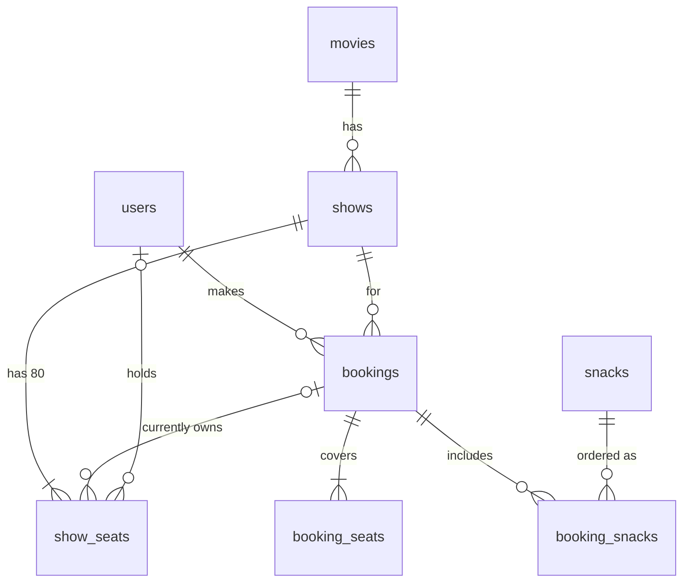

# Yozigo Cinema: Movie Ticket Booking

A movie ticket booking app for a single-screen cinema. Customers browse shows, pick seats on an 8 × 10 seat map, hold them for 5 minutes and pay through a simulated gateway. Admins manage movies and shows and see how full each show is. **A seat can never be booked twice**: the database enforces this, and a test proves it.

| Part     | Choice |
|----------|--------|
| Frontend | React 19 + TypeScript (Vite), React Router, TanStack Query, plain CSS, Lenis (smooth scroll) |
| Backend  | Node.js + Express 5 + TypeScript, REST API, Zod validation |
| Database | PostgreSQL 16, raw SQL via `pg`, SQL migrations |
| Auth     | Email + password (bcrypt), JWT in an httpOnly cookie |
| Tests    | Vitest + Supertest against a real Postgres (38 tests) |

A one-file summary of everything below (setup, accounts, flows, decisions, database design) is in [docs/Yozigo-Submission-Ashika-Mishra.pdf](docs/Yozigo-Submission-Ashika-Mishra.pdf).

---

## Run it locally

Requirements: **Node 20+** and **Docker**.

### Option A: development mode (hot reload)

```bash
# 1. Database (Postgres in Docker, exposed on localhost:5434)
docker compose up -d db

# 2. Backend: http://localhost:4000
cd backend
cp .env.example .env
npm install
npm run migrate
npm run seed          # demo users, movies, snacks and shows for the next 5 days
npm run dev

# 3. Frontend: http://localhost:5173  (new terminal)
cd frontend
npm install
npm run dev
```

Open **http://localhost:5173**. Vite proxies `/api` to the backend, so the browser sees a single origin.

### Option B: everything in Docker

```bash
docker compose up --build -d
docker compose exec app node dist/scripts/seed.js
```

Open **http://localhost:8080**. The API container serves the built frontend.

### Run the tests

```bash
docker compose up -d db
cd backend && npm test
```

The tests create and migrate their own database (`movie_booking_test`), so they never touch your dev data.

> Re-running `npm run seed` is safe. It tops up shows for the next 5 days, so the demo always has bookable shows.

## Test accounts (from the seed script)

| Role     | Email                   | Password      |
|----------|-------------------------|---------------|
| Admin    | admin@cinema.test       | admin12345    |
| Customer | customer@cinema.test    | customer123   |
| Customer | customer2@cinema.test   | customer123   |

The second customer is for trying the "two people book the same seat" case in two browser windows. Use a normal and a private window, because the login is a cookie.

---

## Flow status

| # | Flow | Status |
|---|------|--------|
| 1 | Sign up and log in | ✅ Done |
| 2 | Browse movies and shows | ✅ Done |
| 3 | Seat map | ✅ Done |
| 4 | Select and hold seats (5-minute hold, countdown) | ✅ Done |
| 5 | Pay (success / failure / retry) and no double booking | ✅ Done, with concurrency tests |
| 6 | My bookings | ✅ Done |
| 7 | Admin: movies and shows | ✅ Done |
| 8 | Bonus: cancel a booking | ✅ Done |
| 9 | Bonus: admin bookings per show | ✅ Done |
| 10 | Bonus: live seat updates | ✅ Done (polling every 3 s) |
| + | Extra: snacks delivered to your seat | ✅ Pre-order food & drinks at checkout, delivered at show start or interval |
| + | Extra: e-ticket with QR code, show-time switcher, colour-coded availability, search & filters | ✅ |

**Known limitations**
- A user can extend a hold by pressing Continue again before it expires (each hold lasts 5 minutes from the last Continue). A real system would cap the total hold time.
- No rate limiting on login. It would be the first thing I'd add before going live.
- No live deployment yet.

---

## Key decisions

1. **Node + Express + TypeScript.** One language across the stack, so API types match the frontend's. Express 5 forwards async errors natively, which keeps handlers short.
2. **Raw SQL instead of an ORM.** The core of this task is concurrency: row locks, transactions and constraints. Writing the SQL by hand makes that logic visible and reviewable instead of hidden behind an ORM.
3. **How double booking is prevented.** Every seat of a show is a row in `show_seats` (80 rows created with the show). Holding and booking run in a transaction:
   - Step 1 locks the requested seat rows with `SELECT … FOR UPDATE`, in a fixed order (sorted by label) so two requests can't deadlock.
   - Step 2 checks the seats are free.
   - Step 3 updates them.

   If two people want the same seat at the same moment, Postgres makes the second wait at the lock. When it continues, it sees the seat taken and fails with a message naming the seat. As a second, independent guard, the `UPDATE`s only touch seats that are still free and check how many rows changed. A seat also has a single `booking_id` column, so it can only ever belong to one booking.
4. **Holds expire lazily.** A seat counts as held only while `hold_expires_at > now()`, so expired holds are ignored by every query and no background job is needed. All time checks use the database clock, never the server's.
5. **Bookings are created only on payment success.** A hold is not a booking, so failed payments leave nothing behind. `booking_seats` keeps the permanent seat list, so a cancelled booking still shows its seats while `show_seats` frees them.
6. **No overlapping shows, enforced by Postgres.** An exclusion constraint on `tstzrange(starts_at, ends_at)` rejects overlaps even if two admins save at once. Changing a movie's duration recomputes its upcoming shows' end times in the same transaction, so this rule can't be bypassed.
7. **Auth.** JWT in an httpOnly, SameSite=Lax cookie, so page scripts (and any XSS) can't read it, and other sites can't send it on POSTs. The user and role are loaded from the database on every request, so role changes apply immediately. Asking for another user's booking returns 404 rather than 403, so the API doesn't reveal whether that booking ID exists.
8. **Live seat updates use polling (every 3 s), not WebSockets or SSE.** Hold expiry is time-based, so push would still need timers. Polling also survives server restarts and multiple instances without shared pub/sub. TanStack Query pauses polling in background tabs. For an 80-seat map it's a tiny request, and it's well within "a few seconds".
9. **Frontend state.** Server state lives in TanStack Query (caching, polling, invalidation). The active hold is read from the server's seat map rather than stored on the client, so refreshing mid-checkout resumes the hold and countdown. The countdown corrects for clock skew using the server's time.

## Design

- **Look:** near-black with two neon accents, electric blue `#4DA3FF` and magenta `#FF2E93`. Blue means "available" and magenta means "yours / act". The display face is Michroma, bundled with the app (no third-party font request). Labels use tracked uppercase. There are no stock photos and no emoji UI icons. Poster placeholders are generated duotones in the brand colours.
- **Glass panels** over a CSS-generated wallpaper (gradients plus an SVG grain, so no image download):
  - Only top-level panels use `backdrop-filter`. Nested cards are flat translucent fills, because stacking blurs is expensive.
  - Text sits on dark glass (≥ 0.66 opacity) to keep WCAG contrast.
  - `prefers-reduced-transparency` and browsers without `backdrop-filter` get solid panels.
- **Layout:**
  - Movie pages follow the large booking sites: a hero card, a date strip, show times colour-coded by how full they are, and a 3-step checkout (seats → snacks → pay) with a sticky order summary.
  - Seats are real buttons, and their state is shown by shape and pattern, not only colour.
- **Smooth scrolling:** [Lenis](https://github.com/darkroomengineering/lenis) via its npm package.
  - It smooths only wheel and trackpad input; touch, keyboard and find-in-page stay native.
  - It glides to in-page anchors, resets to the top on navigation and pauses while a dialog is open.
  - It's switched off for `prefers-reduced-motion`.

## Security notes

- Passwords are hashed with bcrypt (cost 10). They must be 8–72 characters, because bcrypt ignores anything after 72 bytes.
- Login compares against a dummy hash for unknown emails, so response time doesn't reveal which emails are registered.
- Every endpoint validates its input with Zod. SQL is always parameterised.
- Every admin route checks the role on the server. The frontend route guards only improve the user experience.
- Helmet sets security headers, including a CSP. Poster URLs must be `http(s)`, which blocks `javascript:` and `data:` URLs. Request bodies are capped at 20 KB.
- In production the JWT secret must be at least 32 characters, and cookies are `Secure`.
- After login the app only redirects back to same-site paths, which prevents open redirects.

---

## Database design



| Table | Columns | Notes |
|-------|---------|-------|
| **users** | id, name, email (unique, lower-case), password_hash, role (`customer`/`admin`), created_at | Admins are created only by the seed script |
| **movies** | id, title, description, poster_url, language, duration_min, rating (`U`/`UA`/`A`), created_at | |
| **shows** | id, movie_id → movies, starts_at, ends_at, price_paise, created_at | `ends_at = starts_at + duration`; **exclusion constraint** blocks overlapping shows |
| **show_seats** | show_id → shows, seat_label (`A1`…`H10`), held_by → users, hold_expires_at, booking_id → bookings | PK (show_id, seat_label). The seat inventory, locked during hold/book |
| **bookings** | id (uuid), user_id → users, show_id → shows, amount_paise, status (`confirmed`/`cancelled`), created_at, cancelled_at | `show_id` is `ON DELETE RESTRICT`: a booked show (or its movie) can't be deleted |
| **booking_seats** | booking_id → bookings, seat_label | Permanent record of a booking's seats |
| **snacks** | id, name (unique), description, category, price_paise, is_veg, icon, available | The food & beverage menu |
| **booking_snacks** | booking_id → bookings, snack_id → snacks, quantity (1–10), unit_price_paise | Price is copied at order time, so menu changes never alter what was paid |

`bookings` also has `snack_delivery` (`show_start` / `interval`, null without snacks), and `movies` has `genre`. The booking total is computed in the transaction from database prices; the client only sends snack IDs and quantities.

Money is stored as integer **paise** (no floating-point rounding). Times are `timestamptz` (UTC). See [001_init.sql](backend/src/db/migrations/001_init.sql) for the CHECK constraints that keep seat state consistent.

## API overview

| Method | Path | Auth |
|--------|------|------|
| POST | `/api/auth/signup`, `/api/auth/login`, `/api/auth/logout` | - |
| GET | `/api/auth/me` | user |
| GET | `/api/movies`, `/api/movies/:id` (with upcoming shows), `/api/shows/:id` | - |
| GET | `/api/shows/:id/seats` | user |
| POST / DELETE | `/api/shows/:id/hold` | user |
| GET | `/api/snacks` | - |
| GET / POST | `/api/bookings` (list / confirm after payment, with optional snacks) | user |
| GET | `/api/bookings/:id` | owner |
| POST | `/api/bookings/:id/cancel` | owner |
| POST / PUT / DELETE | `/api/admin/movies[/:id]` | admin |
| GET / POST / DELETE | `/api/admin/shows[/:id]`, GET `/api/admin/shows/:id/bookings` | admin |

Errors are always `{ "error": { "code", "message", "details?" } }`. Clients branch on the `code` (e.g. `SEATS_UNAVAILABLE`, `HOLD_EXPIRED`).

## Tests

`backend/test/` runs against a real Postgres, because what needs testing (locks, constraints, transactions) only exists there:

- **double-booking.test.ts**
  - 2 users hold the same seat at once
  - a test that *forces* the two transactions to overlap (a third connection holds the row lock until both requests are queued). Removing the locks makes this test fail.
  - 20 users race end to end for one seat
  - a double-clicked Pay creates one booking
- **auth.test.ts**: hashing, duplicate email, generic login error, logout, protected APIs.
- **bookings.test.ts**: holds, 6-seat limit, expiry, paying after expiry, snacks priced by the server (a client-sent price is ignored), unavailable snacks, privacy of bookings, ordering, cancellation window.
- **admin.test.ts**: role checks, CRUD, overlap rules, delete rules, stats, time zone conversion.

## Credits

Demo films are real releases; their posters are hotlinked from each film's English Wikipedia article (the infobox image). They remain the copyright of their studios and are used for demonstration only. Runtimes come from the same articles. TMDB was the first choice, but its site is not reachable from the network this was built on, so Wikipedia was used as the poster source. If a poster can't load, the app falls back to a generated title card.

## Assumptions

- The cinema is in India: times are entered and shown in **IST** (`CINEMA_TIMEZONE`), whatever the viewer's computer is set to.
- "Shows that have already started are not listed" also means they can't be held or booked.
- Pressing Continue again with a different selection replaces the user's previous hold for that show.
- A booking can be cancelled while the show is more than 2 hours away. Cancelled bookings still count as "has bookings" when deciding whether a show can be deleted, which keeps the history intact.
- "Seats still available" excludes seats currently held by someone else.

## Project structure

```
backend/src
  modules/{auth,movies,shows,bookings,admin}   routes + services per feature
  db/        pool, migration runner, migrations/*.sql
  lib/       errors, validation, seat helpers
  middleware/auth.ts
backend/test  integration tests
frontend/src
  api/       fetch client, types, query definitions
  auth/      session hooks and route guards
  components/ SeatMap, Countdown, Layout, UI primitives
  pages/     customer pages; pages/admin is lazy-loaded
```
